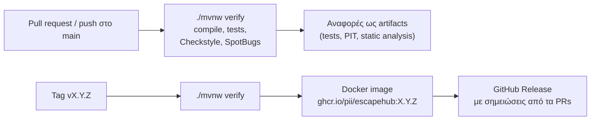

# Αρχικό αρχιτεκτονικό σχέδιο

> **Κατάσταση:** Πρώτη έκδοση (Sprint 0). Οι σημαντικές αποφάσεις καταγράφονται ως [ADRs](adr/README.md).

## 1. Στόχοι και περιορισμοί

- Backend σε **Java** με **Spring Boot** (υποχρεωτικό, Ενότητα 5).
- Απλό, λειτουργικό web UI. Η αξιολόγηση εστιάζει στη μηχανική λογισμικού, όχι στο UI.
- Οι κανόνες της αποστολής πρέπει να είναι **ελέγξιμοι χωρίς βάση και δίκτυο**, και κατάλληλοι για mutation testing.
- Οι σωστές απαντήσεις δεν πρέπει να εξαρτώνται από ζωντανά δεδομένα (MVP-7).
- Νέα αποστολή πρέπει να προστίθεται **μόνο με δεδομένα** (MVP-9).
- Μία εκτελέσιμη μονάδα για εύκολο CI/CD και Docker Compose.

## 2. Modules

```text
com.escapehub
├── user       μοναδικό όνομα παίκτη, αναγνώριση μέσω cookie
├── team       ομάδες παικτών, δημιουργός και μέλη, κωδικός πρόσκλησης
├── mission    ορισμοί αποστολών: φόρτωση και επικύρωση αρχείων, κατάλογος
├── game       playthroughs, κανόνες ξεκλειδώματος, τύποι γρίφων   ← PIT
├── journal    κοινό ημερολόγιο στοιχείων
├── external   adapters Wikidata / Open Library, resilience, snapshots
└── common     σφάλματα (ProblemDetail), ρυθμίσεις, κοινοί τύποι
```

| Module | Ευθύνη | Βασικές εξαρτήσεις |
|--------|--------|--------------------|
| `user` | Παίκτες με μοναδικό όνομα, αναγνώριση από cookie. Χωρίς κωδικούς (απόφαση PO). | Spring Security (μόνο ένα φίλτρο), JPA |
| `team` | Δημιουργία ομάδας, συμμετοχή με κωδικό, ρόλος CREATOR/MEMBER | `user` |
| `mission` | Φόρτωση αρχείων αποστολών, επικύρωση στην εκκίνηση, κατάλογος | – |
| `game` | Κατάσταση playthrough, αξιολόγηση κανόνων, επικύρωση απαντήσεων | `mission`, `journal` |
| `journal` | Καταχώριση στοιχείων, ταυτόχρονη πρόσβαση | JPA |
| `external` | Κλήσεις APIs, μετατροπή σε DTOs, timeouts, retries, snapshots | Spring `RestClient`, Resilience4j |

Κάθε module έχει τα επίπεδα **web** (controllers) → **application** (services, transactions) → **domain** (καθαρή Java) → **infrastructure** (repositories, HTTP clients).

Η λογική του `game.domain` **δεν εξαρτάται από το Spring**. Έτσι:

- ελέγχεται με απλά unit tests σε χιλιοστά του δευτερολέπτου,
- το PIT τρέχει γρήγορα πάνω της (Ενότητα 4.3).

### Αναζήτηση σε εξωτερική πηγή

1. Το UI καλεί π.χ. `GET /api/sources/openlibrary/search?q=...`.
2. Το `external` ελέγχει πρώτα την cache. Αν δεν υπάρχει εγγραφή, καλεί την πηγή με timeout, rate limit και User-Agent.
3. Η απόκριση μετατρέπεται σε ουδέτερο DTO, π.χ. `BookResult(title, authors, firstPublishYear, authorIds)`.
4. Αν υπάρξει σφάλμα, timeout ή απρόσμενη μορφή, ο adapter επιστρέφει το snapshot, αν υπάρχει, με `source: SNAPSHOT`, και το UI εμφανίζει σχετική ένδειξη.

## 3. Οριζόντια θέματα

| Θέμα | Προσέγγιση |
|------|------------|
| **Ταυτότητα παίκτη** | Δεν υπάρχει login (απόφαση PO). Ο παίκτης δίνει μοναδικό όνομα. Ο server δημιουργεί τυχαίο token και το στέλνει σε cookie `HttpOnly`, `SameSite=Lax`, με διάρκεια π.χ. 30 ημέρες. Στη βάση κρατάμε μόνο το hash του token. Ένα φίλτρο του Spring Security αναγνωρίζει τον παίκτη σε κάθε αίτημα, ώστε να λειτουργούν κανονικά οι έλεγχοι 401/403. |
| **Παράκαμψη κανόνων** | Το backend είναι η μόνη πηγή αλήθειας. Σε κάθε αίτημα ελέγχει ότι ο χρήστης είναι μέλος της ομάδας και ότι ο γρίφος ή το στοιχείο είναι διαθέσιμο. Οι σωστές απαντήσεις δεν στέλνονται ποτέ στον client. Κλειδωμένος γρίφος → 409, ξένο playthrough → 403. |
| **Ταυτόχρονη ενημέρωση** | Μοναδικό κλειδί στο `JOURNAL_ENTRY` (η ίδια καταχώριση είναι idempotent) και `@Version` (optimistic locking) στο `PLAYTHROUGH`. Σε σύγκρουση, έως 3 επαναλήψεις. Η αξιολόγηση κανόνων είναι ντετερμινιστική, άρα η επανάληψη είναι ασφαλής. |
| **Σφάλματα** | `ProblemDetail` (RFC 9457) με ενιαίο `@RestControllerAdvice` |
| **Ρυθμίσεις και μυστικά** | Μεταβλητές περιβάλλοντος και Spring profiles (`dev`, `test`, `prod`). Κανένα μυστικό στο αποθετήριο. Στο CI χρησιμοποιούμε GitHub Secrets. |
| **Έκδοση στην εφαρμογή** | Goal `build-info` του `spring-boot-maven-plugin` και `git-commit-id-maven-plugin`. Το `/actuator/info` δείχνει έκδοση και commit. |
| **Τεκμηρίωση API** | springdoc-openapi (`/swagger-ui.html`) |
| **Migrations** | Flyway |

## 4. CI/CD



- **Workflows:** `.github/workflows/ci.yml` για PR και `main`, `.github/workflows/release.yml` για tags `v*`.
- **Docker:** multi-stage `Dockerfile`, με build σε JDK 25 και εκτέλεση σε JRE 25. Το `compose.yaml` τρέχει μια έκδοση μόνο από το image με συγκεκριμένο tag. Η PostgreSQL προστίθεται στο Sprint 1 (TS-05).
- **Στατική ανάλυση:** Checkstyle και SpotBugs ως μέρος του `verify`. Σε αποτυχία, το build σταματά.

## 5. Frontend (ανοιχτή απόφαση)

| Επιλογή | Υπέρ | Κατά |
|---------|------|------|
| **Thymeleaf** (server-side rendering), προαιρετικά με htmx | Ένα project, ένα build, ένα image. Απλή αναγνώριση παίκτη με cookie. Όλη η ομάδα γράφει Java. | Λιγότερο «σύγχρονο» UI |
| SPA (π.χ. React + Vite) | Πλούσιο UI, καθαρός διαχωρισμός | Δεύτερο build και toolchain, CORS/tokens, περισσότεροι έλεγχοι |

**Πρόταση:** Thymeleaf, για να μείνει ο χρόνος στη μηχανική λογισμικού. Το REST API υπάρχει ούτως ή άλλως, για τους ελέγχους και το OpenAPI. Χρειάζεται συνεννόηση με τον διδάσκοντα (Ενότητα 5) και ADR.