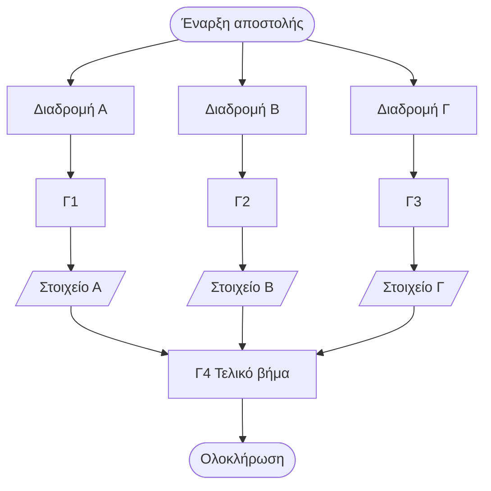

# Περίγραμμα αποστολής: «<!-- τίτλος -->»

> **Κατάσταση:** Πρόταση προς έγκριση από τον Product Owner.

<!--
Οδηγίες συμπλήρωσης (διαγράψτε τα σχόλια όταν συμπληρωθούν οι ενότητες):
- Το θέμα μπορεί να είναι το ενδεικτικό σενάριο της Ενότητας 2.1 της εκφώνησης ή δικό μας, σε συνεννόηση με τον διδάσκοντα.
- Κάθε σωστή απάντηση πρέπει να βρίσκεται σε δημόσια πηγή (π.χ. Wikidata, Open Library) και να έχει επαληθευτεί με πραγματική κλήση.
- Προτιμάμε απαντήσεις που δεν αλλάζουν με τον χρόνο (έτος, όνομα, τόπος) και όχι πλήθη ή κατατάξεις.
- Κάθε γρίφος ανήκει σε έναν από τους γενικούς τύπους παρακάτω, ώστε μια δεύτερη αποστολή να προστίθεται μόνο με δεδομένα (MVP-9).
-->

## Υπόθεση

<!-- 3–5 προτάσεις: τι βρίσκει η ομάδα στην αρχή, ποιος είναι ο τελικός στόχος, ποια αντικείμενα ή στοιχεία ξεκινούν τις διαδρομές. -->

## Απαιτήσεις MVP που καλύπτει

| Απαίτηση | Πώς καλύπτεται |
|----------|----------------|
| ≥ 3 διαδρομές, με οποιαδήποτε σειρά (MVP-3) | |
| ≥ 4 γρίφοι συνολικά (MVP-3) | |
| Γρίφος με εξωτερικά δεδομένα (MVP-5) | |
| Γρίφος με διαδοχικές ενέργειες (MVP-5) | |
| Γρίφος με συμβολή ≥ 2 χρηστών (MVP-5) | |
| Τελικό βήμα από ευρήματα διαφορετικών διαδρομών (MVP-4) | |
| Συσχέτιση δύο πηγών ή μεταφορά ευρήματος από τη μία στην άλλη (MVP-6) | |
| Σταθερές απαντήσεις, ανεξάρτητες από αλλαγές στις πηγές (MVP-7) | |

## Διαδρομές και γρίφοι

<!-- Διάγραμμα: προσαρμόστε τα ονόματα. Κάθε διαδρομή καταλήγει σε ένα στοιχείο που χρειάζεται το τελικό βήμα. -->

Τύποι γρίφων:

| Τύπος | Συμπεριφορά |
|-------|-------------|
| Ελεύθερη απάντηση | Ο παίκτης γράφει απάντηση, που συγκρίνεται με τις αποδεκτές τιμές (χωρίς διάκριση κεφαλαίων, τόνων και κενών) |
| Διαδοχικές ενέργειες | Ενέργειες με συγκεκριμένη σειρά. Λάθος βήμα μηδενίζει την ακολουθία. |
| Συνεργασία | Απαιτεί συνεισφορές από τουλάχιστον 2 διαφορετικούς χρήστες, όχι απαραίτητα ταυτόχρονα |
| Συνδυασμός | Επιλογή συγκεκριμένων στοιχείων από το ημερολόγιο ή συμπλήρωση πεδίων |

<!-- Για κάθε γρίφο, αντιγράψτε το παρακάτω μπλοκ. -->

### Διαδρομή Α: <!-- όνομα -->

**Γ1: <!-- τίτλος -->** (<!-- τύπος, π.χ. Ελεύθερη απάντηση με εξωτερικά δεδομένα -->)

- Τι κάνει ο παίκτης:
- Πηγή δεδομένων και αίτημα: <!-- π.χ. Wikidata wbsearchentities, Open Library search.json -->
- Ερώτηση:
- Σωστή απάντηση: <!-- και εναλλακτικές αποδεκτές γραφές -->
- Επαλήθευση: <!-- ημερομηνία πραγματικής κλήσης και τι επέστρεψε -->
- Στοιχείο που προστίθεται στο ημερολόγιο:

### Διαδρομή Β: <!-- όνομα -->

### Διαδρομή Γ: <!-- όνομα -->

### Τελικό βήμα

<!-- Ποια στοιχεία από ποιες διαδρομές απαιτεί και ποιος είναι ο σωστός συνδυασμός. -->

## Στοιχεία και κανόνες ξεκλειδώματος

| ID | Στοιχείο | Αποκαλύπτεται όταν |
|----|----------|--------------------|
| E1 | | |
| E2 | | |
| E3 | | |

| Γρίφος | Ξεκλειδώνει όταν υπάρχουν |
|--------|---------------------------|
| Γ1 | από την αρχή |
| Γ2 | |
| Γ3 | |
| Γ4 | |

Σειρές ολοκλήρωσης για τους ελέγχους (Ενότητα 4.3, σενάριο 2). Χρειάζονται τουλάχιστον δύο διαφορετικές:

1.
2.

## Πηγές δεδομένων

| Πηγή | Γρίφοι | Endpoint | Τι αποθηκεύεται ως snapshot |
|------|--------|----------|-----------------------------|
| | | | |
| | | | |

## Ανοιχτά ερωτήματα προς τον Product Owner

1.

## Δεύτερη αποστολή (MVP-9)

<!-- Μια μικρή δεύτερη αποστολή (π.χ. 2 διαδρομές, 3 γρίφοι) που χρησιμοποιεί ΜΟΝΟ τους τύπους γρίφων παραπάνω. Θέμα σε μία-δύο προτάσεις. -->

## Έγκριση

| Ημερομηνία | Απόφαση του Product Owner | Σχόλια |
|------------|---------------------------|--------|
| | | |
